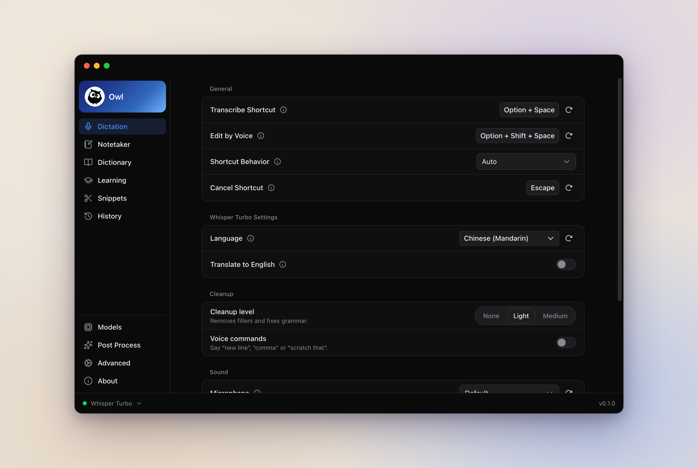
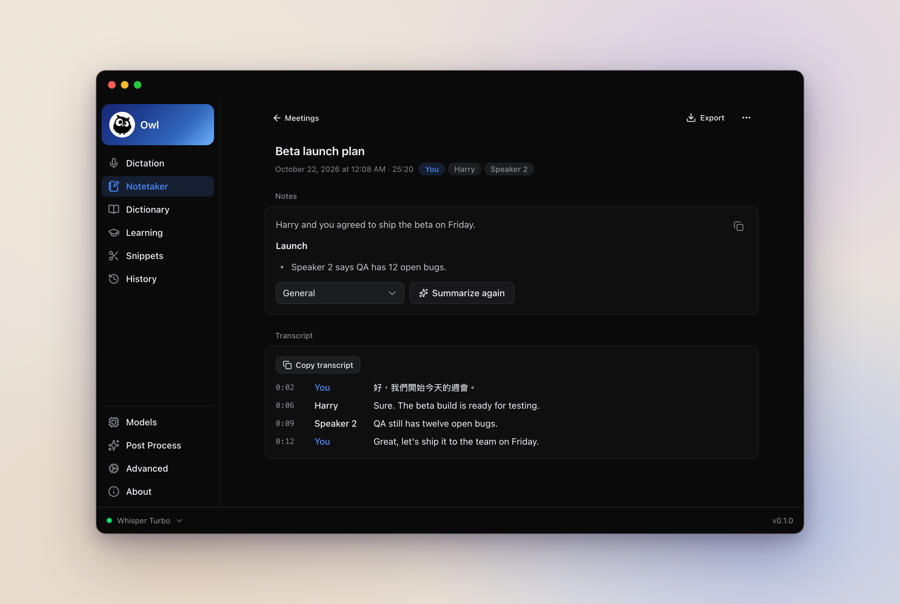

# Owl

English | [简体中文](README.zh-CN.md) | [繁體中文](README.zh-TW.md)

**Private dictation and meeting notes, in English and Chinese. An open-source Wispr Flow alternative.**

Press Option+Space, talk, and Owl types what you said into the app you're in.
Speech recognition runs on your computer. Owl also cleans up filler words, edits
selected text by voice and takes meeting notes.

Owl started as a fork of [Handy](https://github.com/cjpais/Handy) by CJ Pais.
It's developed on its own now and isn't affiliated with Handy, so please file
Owl issues here. Its look borrows from [Wispr Flow](https://wisprflow.ai),
which it isn't affiliated with either.



## Features

- **Dictation.** Hold Option+Space while you talk, or tap it to start and tap
  again to stop. Escape cancels. If no text box has focus when you finish, Owl
  leaves the text on your clipboard and shows a Copy button.
- **English and Chinese.** Several speech models handle Mandarin and English
  in one sentence. Owl writes Chinese in Traditional or Simplified characters.
- **Cleanup.** Owl removes filler words and stutters on your computer. With an AI
  provider it also fixes grammar, numbers and lists.
- **Edit by voice.** Select text, press Option+Shift+Space and say what to
  change. Needs an AI provider.
- **Dictionary and snippets.** Teach Owl names it gets wrong, and save text
  you can paste by saying a phrase like "my email". When you fix a word right
  after dictating, Owl offers to add it to the dictionary.
- **Learning.** Off by default. Owl tries changes to its own settings and keeps
  the ones that score better on your recent dictations. Each one can be undone.
- **Meeting notes.** Owl records your mic and the call, writes a live
  transcript and labels who said what. With an AI provider it writes the notes
  too.
- **Command line and AI agents.** The `owl` command prints and transcribes
  meetings, and `owl mcp` lets agents like Claude Code read them.



The screenshots use Owl's fake demo data.

## Privacy

Speech recognition, speaker labels and echo removal run on your computer. Your
audio and text only leave it if you turn on an AI step and pick a hosted
provider. The only other network use is downloading the models you choose.

For AI steps you can use Apple Intelligence on macOS 26, a local server such
as Ollama, or OpenAI, Anthropic, OpenRouter, Groq, Cerebras, Z.AI or Amazon
Bedrock with your own key. You can also sign in with ChatGPT and use your
plan.

Owl keeps the audio of your last 5 dictations, plus any you save. Your data
lives in `~/Library/Application Support/com.hao.owl/`.

## Status

Early, and built for one person's daily use. There are no downloads yet, so
you build Owl yourself. I build and use it on macOS 26. The Windows and Linux
code is there but untested.

## Requirements

- [Rust](https://rustup.rs) 1.99 or newer
- [Bun](https://bun.sh) 1.4 or newer
- [CMake](https://cmake.org/download/)

Meeting notes need macOS 14.2 or later to hear the other side of a call.
For Windows and Linux, [Handy's build notes](https://github.com/cjpais/Handy/blob/main/BUILD.md)
list what you need.

## Install

### 1. Build

```bash
git clone https://github.com/FOwen123/Owl.git
cd Owl
bun install
bun run tauri build
```

The first build takes a while. If CMake fails with a message about an old
policy version, run `CMAKE_POLICY_VERSION_MINIMUM=3.5 bun run tauri build`.

### 2. Install and open

```bash
cp -R src-tauri/target/release/bundle/macos/Owl.app /Applications/
open /Applications/Owl.app
```

Owl asks for Microphone and Accessibility access. Accessibility is how it
pastes into other apps. Then pick a speech model to download. Qwen3-ASR 1.7B
is good with Mandarin and English mixed. Parakeet Unified is fast for English
only.

Your first meeting also asks for System Audio Recording, so Owl can hear the
call.

### Update

```bash
cd Owl
git pull
bun install
bun run tauri build
osascript -e 'quit app "Owl"'
rm -rf /Applications/Owl.app
cp -R src-tauri/target/release/bundle/macos/Owl.app /Applications/
tccutil reset Accessibility com.hao.owl
open /Applications/Owl.app
```

macOS treats every rebuild as a new app, so the old Accessibility switch stops
working. The `tccutil` line clears it, and Owl asks again. Your settings,
history and meetings stay.

### Uninstall

Quit Owl and delete `/Applications/Owl.app`. To remove your data too, delete
`~/Library/Application Support/com.hao.owl/`.

## Command line

Install the `owl` command from **Advanced > Other apps > Command line** in
Owl's settings.

```bash
owl meetings                 # list meetings
owl meeting 12               # print one as Markdown
owl transcribe call.m4a      # transcribe a file as a new meeting
owl --toggle-transcription   # start or stop dictation
```

To let Claude Code read your meetings and dictations, run
`claude mcp add owl -- owl mcp`. It can only read.

## Troubleshooting

### Shortcuts stopped working (Secure Input)

macOS Secure Input is probably on. Password fields and some apps turn it on,
and it usually goes away by itself. To find the app holding it, run
`ioreg -l -w 0 | grep kCGSSessionSecureInputPID`, then `ps -p <PID>`, and quit
that app.

### Accessibility stays on "Waiting..." after a rebuild

Quit Owl, run `tccutil reset Accessibility com.hao.owl`, open Owl and allow it
again.

### Meetings only have my side

Turn Owl on in **System Settings > Privacy & Security > System Audio
Recording**.

[BUILD.md](BUILD.md) has more, including build errors.

## Contributing

Issues and pull requests are welcome. [BUILD.md](BUILD.md) covers development
and the checks to run, [AGENTS.md](AGENTS.md) the code layout, and
[DESIGN.md](DESIGN.md) the look.

## Credits

- [Handy](https://github.com/cjpais/Handy) by CJ Pais and contributors. Owl is
  built on it.
- [transcribe.cpp](https://github.com/handy-computer/transcribe.cpp),
  [ggml / whisper.cpp](https://github.com/ggml-org/whisper.cpp),
  [transcribe-rs](https://github.com/cjpais/transcribe-rs) and
  [Silero VAD](https://github.com/snakers4/silero-vad) for speech recognition.
- [Streaming Sortformer v2.1](https://huggingface.co/handy-computer/diar_streaming_sortformer_4spk-v2.1-gguf)
  by NVIDIA for speaker labels.
- [LocalVQE](https://github.com/localai-org/LocalVQE), Apache-2.0, for echo
  removal.

## License

MIT, like Handy. Handy's copyright notice is kept in [LICENSE](LICENSE).
